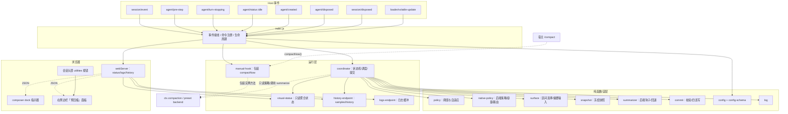
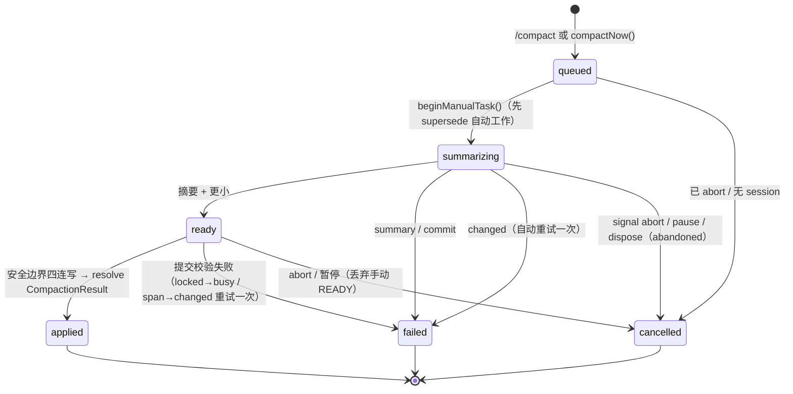
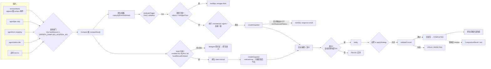
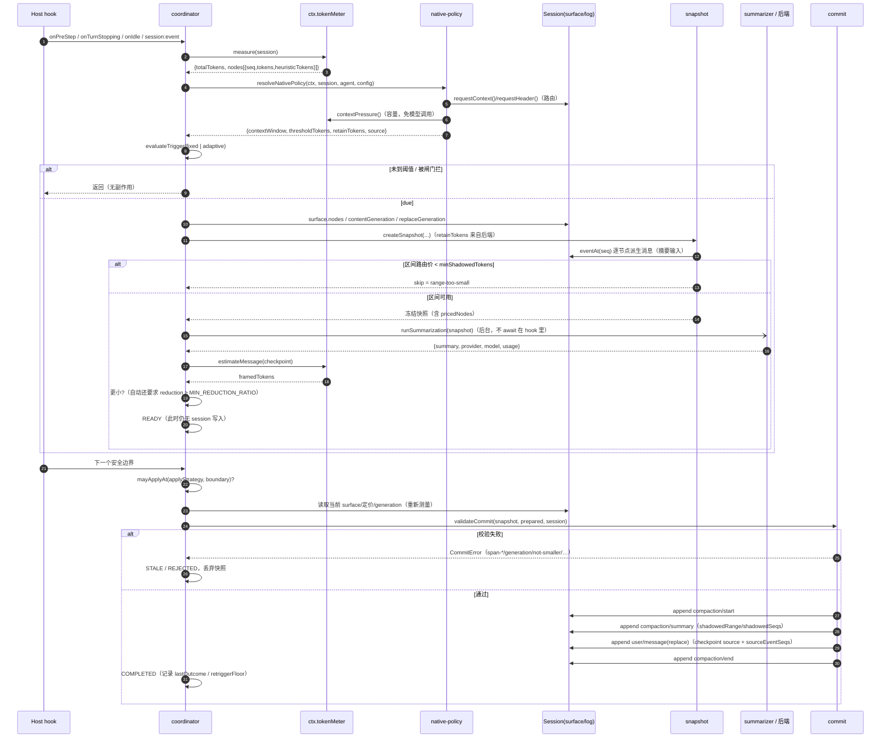
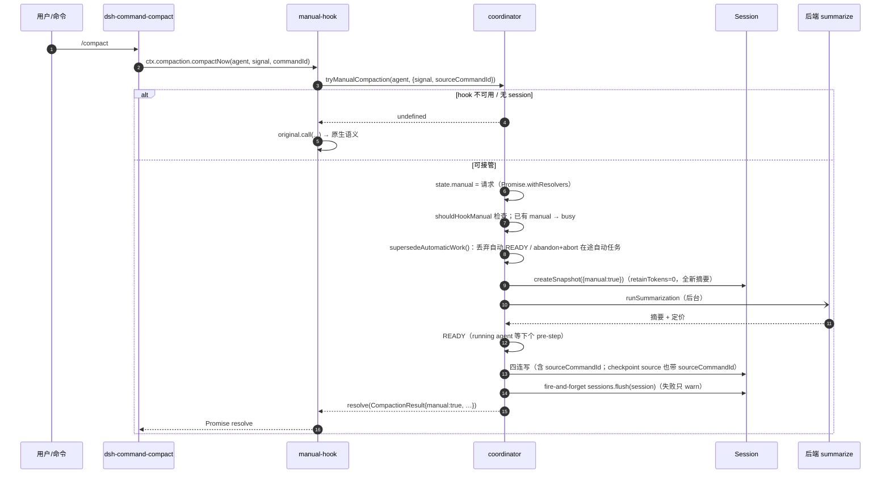
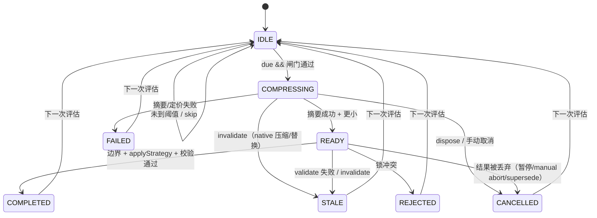

# 02 · 方案设计：锁外摘要 + 原子落地

> 本文件是"怎么做"的正式设计：选定方案、模块边界、数据流、时序、状态机、不变量、配置落地与失败路径。所有描述以当前工作树代码为准（`index.js`、`src/*`、`client.js`）。
>
> 契约边界（当前版本的核心收敛）：本插件只接管**"何时压缩 + 异步执行"**——触发、快照、后台摘要调度、安全边界原子提交、手动 `/compact` 异步化；**不接管"如何压缩"**（保留区间、摘要模型、摘要质量、模型作用域归当前压缩后端或其它压缩插件）。

## 目录

- [1. 问题与约束](#1-问题与约束)
  - [1.1 要消灭的成本](#11-要消灭的成本)
  - [1.2 平台给的硬约束](#12-平台给的硬约束决定了方案空间)
  - [1.3 设计目标](#13-设计目标)
  - [1.4 契约边界：异步调度层 vs 压缩语义层](#14-契约边界异步调度层-vs-压缩语义层)
- [2. 三个候选方案](#2-三个候选方案)
- [3. 架构](#3-架构)
  - [3.4 手动路径：为什么包装 `compactNow`，而不是注册一个 `/compact`](#34-手动路径为什么包装-compactnow而不是注册一个-compact)
  - [3.5 手动请求的生命周期（`state.manual`）](#35-手动请求的生命周期statemanual)
- [4. 数据流](#4-数据流)
- [5. 快照 → 提交时序](#5-快照--提交时序)
- [6. 状态机](#6-状态机)
- [7. 安全不变量清单](#7-安全不变量清单)
- [8. 边界准入与配置落地](#8-边界准入与配置落地)
  - [8.1 三个边界](#81-三个边界)
  - [8.2 落地策略矩阵](#82-落地策略矩阵)
  - [8.3 配置如何影响调度](#83-配置如何影响调度)
  - [8.4 插件页设置卡片与 volatile 就地更新](#84-插件页设置卡片与-volatile-就地更新)
  - [8.5 状态提示：HTTP 只读资源 + composer dock 指示器](#85-状态提示http-只读资源--composer-dock-指示器)
  - [8.6 调试日志：双写 + 环形缓冲 + 只读端点](#86-调试日志双写--环形缓冲--只读端点)
  - [8.7 右侧边栏「预压缩」面板：注册 + 数据契约 + SVG](#87-右侧边栏预压缩面板注册--数据契约--svg)
- [9. 失败模式与降级路径](#9-失败模式与降级路径)
- [附：与 natives 的逐项对齐表](#附与-natives-的逐项对齐表)

---

## 1. 问题与约束

### 1.1 要消灭的成本

原生压缩（`dsh-compaction-basic`）在 `agent/pre-step` 里检查 `totalTokens ≥ thresholdTokens`，一旦命中就**同步 `await` 一次完整的摘要**，然后 `compactRegion` 四连写替换历史。摘要期间：

- 主循环停在 `next()` 上，用户输入/工具结果只能排队；
- 压缩完成后上下文骤降，KV 缓存大面积失效；
- 若摘要比预期慢，Agent 的"思考节奏"被直接打断。

成本可以拆成两笔：

1. **判断太晚**：原生阈值是"窗口的 80%（再被输出预留与 headroom 压低）"，到点才动手，没有提前量；
2. **摘要太慢且在主路径**：模型调用必须发生在 `pre-step` 里，无法与 Agent 的其它工作重叠。

本插件的答案是：**提前判断 + 锁外后台摘要 + 安全边界原子提交**。判断可以早（固定或自适应阈值），摘要可以慢（后台），但提交必须是同步、原子、可校验的四连写。

同样的成本还有第二处：用户主动 `/compact` 走 `ctx.compaction.compactNow()`，它在 `agent.runMaintenance()` 里**同步**跑完摘要，期间新输入只能等，运行中的 turn 直接报 `busy`。**manual hook 把这一处也移到后台**：命令仍然等待，但不再占用维护窗口、不再阻塞新输入。

### 1.2 平台给的硬约束（决定了方案空间）

| # | 约束 | 影响 |
|---|---|---|
| C1 | `CompactionEngine` 以固定服务名 `compaction` 注册，**每个 context 只能有一个实现** | 不能"再挂一个压缩服务"；要么用它，要么替换它 |
| C2 | `compactRegion/compactNow/compactIfNeeded` 都**没有**"传入现成摘要"或"分离 prepare/commit"的参数 | 无法把后台算好的摘要塞回原生入口；只能**接管入口**（包装方法）或**替换后端** |
| C3 | `compactRegion` 必须已有 open turn，且在内部取锁→await 摘要→提交；`compactNow` 要求 agent idle 且保留区间为"只留最后一个节点" | 原生两条入口都阻塞；manual hook 只在"自己的流水线可用时"接管，原生语义作为 delegate 保留 |
| C4 | `session.append` 是公开 API，`compaction/*` 是已知事件类型；第三方可写四连写；**session 层不校验 tool-pair 平衡** | "自己提交"可行，但平衡必须自担 |
| C5 | 持久化读路径拒绝未知且非 `ignorable` 的事件类型 | 不能自造事件类型，只复用 `compaction/*` |
| C6 | `session/event` 是同步 `emit`；append 发布期间**禁止重入 append** | 不能在事件监听器里直接 commit；必须先排到边界 |
| C7 | 只有 surface 节点 0 的 `system/message` 被排除在压缩范围外；`replace` 必须精确三键 `{op,startSeq,endSeq}`，且 `sourceEventSeqs` 必须覆盖全部被遮蔽节点 | 落地写法被严格约束 |
| C8 | `contentGeneration`（replace + 消息投影）与 `replaceGeneration`（仅 replace）是两个单调计数器 | 现成的"快照是否还新鲜"判据 |
| C9 | 命令按名称唯一注册（重名直接抛错），**没有替换他人命令的 API**；`/compact` 的 handler 只调用 `ctx.compaction.compactNow(...)` | 想让 `/compact` 异步化，只能包装 `compactNow`（方案 B + manual hook），不能注册同名命令 |
| C10 | 压缩后端的保留策略/摘要模型/质量门槛是**后端自有语义**（不同后端/版本可能不同） | 调度层不应复制这套策略；应"读后端、跟随其后端"，否则会与其它压缩插件冲突 |

### 1.3 设计目标

1. **主循环零等待**：任何 hook 里都不 await 模型调用。
2. **产物与原生同语义**：同样的提示词、同样的 `<compacted-summary>` 框架、同样的 `compact-checkpoint` source、同样的四事件与 payload 形状——让 `/compact`、持久化、续接、UI 消费者都把它当普通压缩。
3. **宁可放弃，不可半落地**：提交是同步事务；任何校验失败 → 原上下文不动。
4. **不替换、不改动原生**：原生是兜底，插件卸载后行为完全回到原生；手动 hook 也遵循"只接管、可还原、失败 delegate"。
5. **显式请求同样不阻塞**：`/compact` 后台化，命令等待的是"落地后的结果"，而不是"维护窗口里的同步摘要"。
6. **可诊断**：每个决策（为什么触发/为什么跳过/为什么被拒）都能在状态与日志里读到。
7. **只接管时机与异步，不接管压缩语义**：保留多少上下文、摘要用什么模型、质量门槛多高、哪些模型参与压缩，都交给当前压缩后端（或其它压缩插件）。本插件不提供这些配置，避免与后端策略/其它压缩插件冲突，也让后端升级时行为自动跟随。

### 1.4 契约边界：异步调度层 vs 压缩语义层

```text
┌───────────────────────────── 异步调度层（本插件） ─────────────────────────────┐
│ 触发判定（固定/自适应阈值、自适应公式、抗抖动）                                  │
│ 快照（区间 seq、generation、逐节点定价）→ 后台摘要 → READY                       │
│ 安全边界原子提交（4 事件） / 手动 /compact 异步化 / 状态与命令                    │
└───────────────────────────────────────────────────────────────────────────────┘
        │ 只“读”后端策略（阈值/headroom/保留区间）与调用 summarize()
        ▼
┌───────────────────────────── 压缩语义层（后端/其它插件） ───────────────────────┐
│ 保留策略（retainRatio/retainTokens：压缩后留下多少）                             │
│ 摘要模型 / provider / 输出上限（后端 summarize 或会话路由）                      │
│ 质量门槛（自动路径本插件用内部常量 MIN_REDUCTION_RATIO=0.05 兜底）               │
│ 模型作用域（哪些 provider/model 值得压缩）                                       │
└───────────────────────────────────────────────────────────────────────────────┘
```

| 语义 | 归属 | 本插件的处理 |
|---|---|---|
| 保留区间（压缩后留多少） | 后端策略（全局 + per-model） | 自动路径完全复用后端的 per-target 合并顺序：目标 `retainTokens` → 目标 `retainRatio`（`floor(messageBudget×ratio)`）→ 全局 `retainTokens` → 全局 `retainRatio` → 内置默认 16%，最后 `min(raw, floor(thresholdTokens×0.9))`；阈值可被显式 `nativeThreshold` 覆盖，保留不受它影响；手动路径固定 `retainTokens=0`（只保留最后一个 surface 节点，工具对自动展开） |
| 摘要模型 / provider / maxTokens | 后端 `summarize()` 或会话路由 | 优先调用后端 `summarize()`；回退路径用会话自身路由 + 常量 `FALLBACK_MAX_TOKENS=65536`；无配置项 |
| 质量门槛 | 本插件内部常量（自动） | `MIN_REDUCTION_RATIO=0.05`（`src/commit.js` 导出，不可配置）；手动路径只要求 `framedTokens < shadowedRouteTokens` |
| 模型作用域 | 后端/安装者策略 | 本插件不过滤；`routeUsable()` 仅判断"路由非空"，当前运行时未使用 |
| 配置键 | 本插件 **16 键** | 已删除 19 个旧键（第一轮 9 个压缩语义键；第二轮 `manualCompactTimeoutSeconds` + 8 个自适应内部调参，含 `growthWindow`；第三轮 `maxConcurrent`，并发改为单会话固定 1）。旧 profile 中的残留被静默忽略；`logBufferSize` 等其余 16 键保留 |
| 自适应内部参数 | `src/internal-policy.js` 固定常量 | 只暴露 `minThreshold`/`maxThreshold`/`fallbackThreshold` 三个配置；安全余量、耗时系数、增长/耗时默认值、突发系数、EMA、采样间隔、统计窗口均不可配 |

**为什么这样切**：压缩语义是"装哪个后端/哪个压缩插件"决定的；调度层如果自带一套保留/模型/门槛，就会与后端策略叠加或打架（例如另一插件把保留尾部调小、本插件又覆盖回去）。把语义交还给后端后，本插件只承诺"在原生压缩之前把摘要算好并原子落地"，后端升级时保留/模型行为自动跟随。

---

## 2. 三个候选方案

### 2.1 方案 A：在 `agent/pre-step` 里 await `compactRegion`

直接调用原生入口：在 `pre-step` 判断达到阈值后 `await ctx.compaction.compactRegion(session, signal)`。

- 优点：零重复实现，完全复用原生语义。
- 缺点：**没有解决任何问题**——`compactRegion` 内部仍然同步摘要；`pre-step` 里 await 仍然阻塞主循环；只是把"原生阈值"换成"插件阈值"，提前一点开始阻塞。

结论：不采用（它优化的是触发时机，不是阻塞）。

### 2.2 方案 B：锁外摘要 + 同步四连写原子提交（采用）

1. 在事件/定时器里测量、判断，**只读**当前 surface 与 token 定价（无锁、无 await 模型）；
2. 需要压缩时固化**快照**（区间 seq、generation、逐节点定价、摘要输入、策略依据）；
3. 用后端 `summarize()`（或回退 `ctx.llm.stream()`）在后台生成摘要与 checkpoint 定价；
4. 摘要就绪后进入 `READY`，等到安全边界（`pre-step` / `turn-stopping` / `idle`）再**同步、无 await** 地做四连写：
   `compaction/start → compaction/summary → user/message(replace) → compaction/end`；
5. 提交前重新校验：区间仍在、节点序列/定价未变、工具对平衡、摘要确实更小；失败则丢弃结果、原上下文不动。

- 优点：主循环只承担"测量 + 四连写"（毫秒级），摘要模型调用完全移出；产物与原生事件形状一致；锁只覆盖四连写，不会把锁持有跨过一次模型调用。
- 缺点：需要自己实现快照/校验/提交（这就是本仓库的大部分代码）；后台结果可能因历史变化而失效（用 generation 校验兜底）。

### 2.3 方案 C：自实现 `CompactionEngine` 替换原生后端

注册一个实现 `CompactionEngine` 的服务，把 `compactRegion/compactNow/compactIfNeeded` 全换成异步版本。

- 优点：入口统一，连原生触发也能"不阻塞"。
- 缺点：**替换了原生语义**（提示词、阈值、保留策略、事件 payload 都要自己维护），与其它压缩插件/后端升级强耦合；一个 context 只能有一个 `compaction` 服务，替换会挤掉原生兜底；风险与维护成本最高。

结论：不作为默认形态。保留为"未来可选后端"（需要用户显式安装/预设），见 docs/05 的 P2。

### 2.4 对比矩阵与结论

| 维度 | A（awaited compactRegion） | B（锁外摘要 + 原子提交，采用） | C（替换后端） |
|---|---|---|---|
| 主循环阻塞 | 有（摘要时长） | **无**（仅毫秒级提交） | 无（但重写全部语义） |
| 复用原生语义 | 完全 | 事件/payload 对齐 + 自校验 | 自己重新实现 |
| 与其它压缩插件共存 | 冲突 | **只接管时机 + 包装手动入口，可 delegate** | 直接冲突 |
| 实现复杂度 | 低 | 中高 | 高 |
| 失败兜底 | 原生 | 原生仍挂载 | 失去原生兜底 |
| 后端升级跟随 | 自动 | 阈值/保留读后端，摘要调用后端钩子 | 不跟随 |

结论：**B 为主方案**；C 仅在用户明确要求"原生触发也不阻塞"时作为可选后端（当前未实现）。manual hook 是 B 的第二个入口：包装 `compactNow`，把显式请求也导向同一条流水线。

---

## 3. 架构

### 3.1 模块图



### 3.2 模块职责

| 模块 | 职责 | 导出 |
|---|---|---|
| `index.js` | 接线 Host 事件（7 个 + `loader/volatile-update`）、注册 `/precompact`、`unwrapConfigRefs` 后建 runtime、注册 manual hook、卸载顺序（先还原 hook 再 dispose） | `name`、`Config`、`apply` |
| `src/coordinator.js` | 运行时状态机：attach、测量、评估、启动后台任务、READY/提交、手动请求槽、`applyConfig`、状态与日志、**每会话 `turn`/`step`/有界 `samples`（120）与 `history`（30）/全量 `steps`**、dispose | `createRuntime`、`PHASE` |
| `src/manual-hook.js` | 包装/还原后端实例的 `compactNow`；判断是否接管；把调用转给 `runtime.tryManualCompaction`；失败 delegate；上报 hook 状态 | `createManualHook` |
| `src/policy.js` | 固定/自适应阈值计算、EMA/峰值、夹取与降级、`usageRatio`；`routeUsable()`（仅判断路由非空，运行时未用） | `evaluateTrigger`、`createGrowthTracker`、`createDurationTracker`、`routeUsable`、`usageRatio` |
| `src/native-policy.js` | 找压缩服务（host/preset）、读后端策略（全局阈值/headroom/保留 + `modelPolicies` per-model 覆盖）、解析路由、取容量并预算阈值；**阈值/保留跟随当前路由命中的后端策略**（返回 `targetPolicy`） | `resolveNativePolicy`、`compactionServiceOf`、`routedTargetOf`、`DEFAULT_NATIVE_*` |
| `src/surface.js` | surface 词汇（5 类事件）、区间选择（保留尾部、工具对平衡、node0 保护）、摘要输入、checkpoint 消息/source | `selectCompactableRange`、`buildSummarizationInput`、`createCheckpointMessage`、`toolPairingBalanced*` |
| `src/snapshot.js` | 冻结快照：区间、节点定价、generation、摘要输入、策略依据；手动路径固定 `retainTokens=0` | `createSnapshot`、`describeSnapshot` |
| `src/summarizer.js` | 首选后端 `summarize()` 钩子并归一化；回退 `ctx.llm.stream()`（会话路由 + 常量 65536）；checkpoint 定价 | `runSummarization`、`prepareCheckpoint` |
| `src/commit.js` | `CommitError`、`validateCommit`、`appendCompaction`、锁检查；**内部常量 `MIN_REDUCTION_RATIO=0.05`** | `appendCompaction`、`validateCommit`、`CommitError`、`MIN_REDUCTION_RATIO`、`compactionLockActive` |
| `src/config.js` | `DEFAULTS`（**16 键**）、`resolveConfig`（逐字段校验 + warning 不失败）、`unwrapConfigRefs`、可选 schemastery schema（行为字段 `.volatile()`，`statusCommand` 除外） | `DEFAULTS`、`resolveConfig`、`unwrapConfigRefs`、`loadConfigSchema` |
| `src/internal-policy.js` | 自适应预测的**固定内部常量**（安全余量/耗时系数/增长与耗时默认值/突发系数/EMA/采样间隔/窗口）；不再是配置项 | `SAFETY_MARGIN_TOKENS`、`COMPRESSION_TIME_MULTIPLIER`、`DEFAULT_COMPRESSION_SECONDS`、`DEFAULT_GROWTH_TOKENS_PER_SECOND`、`BURST_GROWTH_FACTOR`、`EMA_ALPHA`、`GROWTH_SAMPLING_INTERVAL_MS`、`GROWTH_WINDOW_MS` |
| `src/config-schema.js` | 能解析 schemastery 就导出 schema，否则 `undefined` | `default` |
| `src/log.js` | 结构化日志**双写**：①按 `logLevel` 转发宿主 logger（单行 `[pre-compact] message key=value`）；②**所有级别**（含 debug）写入内存环形缓冲，容量动态读 `logBufferSize`（0=关闭并清空）；字段经 `sanitizeFields()` 有界化（字符串 300、数组 20、深度 3、循环/Error/BigInt/函数安全）；API `snapshot/clear/stats` | `createLogger`、`formatFields`、`sanitizeFields`、`DEFAULT_LOG_BUFFER_SIZE` |
| `src/logs-endpoint.js` | 只读日志端点 `GET /api/pre-compact/logs`：limit 1..500（默认 100）、level 最低级别、sessionId 精确、sinceSeq 排他；同源校验 + `no-store`；返回 `{ok,version,now,count,capacity,lastSeq,records}`；复用 `visual-status` 的 `jsonResponse/sameOriginAllowed` | `createLogsResource`、`LOGS_PATH` |
| `src/util.js` | clamp/round/errorChain 等小工具 | — |
| `src/visual-status.js` | 只读状态资源：把 `runtime.statusFor(sessionId)` 压成 `{ok,version,now,state,phase,enabled,manual,startedAt,outcome,failure}`；`state ∈ idle/working/ready/done(8s)/failed(8s)`；`GET /api/pre-compact/status` 同源校验 + sessionId 白名单 + `no-store`；不含消息内容；同时导出 `jsonResponse`/`sameOriginAllowed` 供日志端点复用 | `buildVisualStatus`、`createStatusResource`、`VISUAL_STATUS_PATH`、`DONE_WINDOW_MS`、`FAILED_WINDOW_MS`、`jsonResponse`、`sameOriginAllowed` |
| `client.js`（浏览器 half） | 四个注册面：`plugins.bundle.config` 设置卡片（**13 字段**/5 分组）+ `conversation.composer.dock` 状态指示器（`order:0`，token 环左侧）+ `conversation.session.header.utilities`「预压缩」按钮（`order:10`，`sidebarRight.openTab('pre-compact')`）+ **右侧边栏 tab**（`sidebarRightTabs.register` + `sidebar.right.pane.tab` body；仪表/统计 chips/紧凑按步趋势/记录表）；绑定 `pre-compact` 命名空间；中英双语 | `inject: ['slots','locale','configForms']`、`ctx.inject(['sidebarRight','sidebarRightTabs'])`、`apply`、`__internals` |
| `src/history-endpoint.js` | 右侧边栏面板只读数据：`GET /api/pre-compact/history?sessionId=…` 返回 `{ok,version,now,sessionId,current,step|null,samples,steps,history}`（**`steps` 全量**）；`current` **20 字段**白名单（`lastFailure` 只 `{at,code}`、`lastSkip` 只 `{at,reason}`、`manualRequest` 三字段、含 `step`）；未知会话空数组（含 `steps: []`）；同源/400/`no-store`/500；复用 `jsonResponse/sameOriginAllowed` | `createHistoryResource`、`HISTORY_PATH` |

### 3.3 关键设计决策

| 决策 | 理由 |
|---|---|
| 只提交"快照区间"，不提交"当前整个 surface" | 快照之后的 append 必须保留；replace 的 `startSeq/endSeq` 只覆盖快照区间，`sourceEventSeqs` 覆盖全部被 shadow 的节点 |
| 每会话一个 `active` + 一个 `ready` | 单会话串行可证（同会话不会有两份摘要争抢提交）；跨会话不设全局上限，多个会话可并行摘要，成本交给模型服务侧 |
| 锁只覆盖四连写 | 摘要模型调用不持锁；否则原生压缩/其它写入会被长时间挡住 |
| 提交前重新测量/校验（stale 检测） | 后台结果可能在 READY 期间失效；`generation` + 区间/定价/平衡校验一起兜底 |
| 不声明硬 `inject` | 缺 token meter / 压缩后端时插件仍可激活并保持惰性，不让 profile 启动失败 |
| 阈值/容量读后端，不复制后端策略 | 后端升级/替换时自动跟随；`nativeThreshold` 只作为显式覆盖 |
| 自适应预测内部参数固定为常量 | 公式不变，但只暴露 3 个阈值窗口/回退；少一个旋钮就少一类"调参后行为不可解释"的问题，也避免与后端阈值策略重复 |
| 手动请求没有插件 deadline | 生命周期归原生压缩语义：Promise 只在落地/abort/卸载/会话失效时 settle；不再维护本地超时计时器 |
| 状态提示走只读 HTTP + 轮询，不写入 session | 摘要在途时没有 `compaction/*` 事件可订阅；HTTP 资源能独立暴露"正在压缩"，且不污染会话日志、不含消息内容（隐私/鉴权边界比写事件更小） |
| 手动请求取代自动工作、共用提交流水线 | 快照/摘要/锁/四连写/校验共用；但手动不复用自动 READY/在途结果——先 `supersedeAutomaticWork()`，再按 `retainTokens=0` 与"只要求更小"重新摘要（代价：自动任务在跑时多一次摘要） |
| 取消用"generation + abandoned"而不是单纯 abort | `cancelActiveManualTask()` 标记任务作废并递增 `state.generation`；`startTask` 在 await 返回后比对 generation/abandoned，晚到的摘要结果直接丢弃 |
| 设置卡片放在 bundle 详情页（`plugins.bundle.config`）而不是 Settings 分区 | bundle 详情页本来就展示该行、与该行配置文档一一对应；再在 Settings 里复制一份会产生两个入口/两份状态 |
| 行为字段全部 `.volatile()`、保存即生效 | Host 每次决策都读 `config` 对象，`applyConfig()` 只需 `Object.assign` + 触发重评估；重启会丢后台任务/manual hook |
| `statusCommand` 保持非 volatile | 它决定 `apply()` 里是否注册命令；运行中改变注册状态属于生命周期变更 |
| **不接管压缩语义**（保留/摘要模型/质量/作用域） | 语义归后端，调度层只"读策略 + 调钩子"；避免与其它压缩插件冲突，后端升级自动跟随 |

### 3.4 手动路径：为什么包装 `compactNow`，而不是注册一个 `/compact`

`dsh-commands` 的注册表按名称唯一：`register()` 只是 `insert(name, …)`，重名会直接抛 `command "<name>" is already registered`，且**没有替换/注销他人命令的公开 API**（见 docs/01 的证据：`COMMANDS:89,266-268`）。`/compact` 已由 `dsh-command-compact` 注册，其 handler 只做一件事：调用 `ctx.compaction.compactNow(agent, signal, commandId)`（`CMD:56`）。因此想让 `/compact` 异步化，只有两条路：

1. 注册同名命令 —— 不可行（重名抛错）；
2. **包装后端实例的 `compactNow`** —— 可行：`/compact` 仍由原命令分发，命令看到的仍是"一个返回 Promise 的 `compactNow`"，但实际执行换成"排队 → 后台摘要 → 安全边界提交"。

包装策略：

- 在 `agent/created`（`agent/pre-step` 兜底）通过 `compactionServiceOf(ctx, agent)` 找后端：host `ctx.get('compaction')` 优先，preset `agentPresets.serviceFor(agent, 'compaction')` 兜底；
- 用 `WeakMap` 记录每个实例的原方法，给实例赋值一个 wrapper；wrapper 在 `enabled && !dryRun && hookManualCompact` 且未卸载时调用 `tryManualCompaction()`，否则 `original.call(...)`；
- 卸载时 `restore()` 写回原方法（即使写回失败，wrapper 也因 `active=false` 直接 delegate）；
- 包装失败（实例冻结/只读/没有 `compactNow`）只 warn，不阻断插件；hook 状态经 `setManualHookState()` 暴露在 `/precompact status`。

### 3.5 手动请求的生命周期（`state.manual`）



- **一个槽**：每会话最多一个 `state.manual`；同会话再来一个请求 → 立即 reject `busy`。
- **取代自动工作（不复用）**：`tryManualCompaction()` 先 `supersedeAutomaticWork()`——自动 READY 会被 `discard(reason='manual-request-supersedes')`，在途自动任务会被标记 `abandoned`、`generation+1`、`abort`，然后**总是启动全新的手动摘要**。这样手动请求不会继承自动保留区间/自动 5% 门槛；代价是自动任务在跑时会多一次摘要（原任务被取消）。
- **绕过**：`applyStrategy`、`minInterval`、`retriggerFloor`、`minShadowedTokens`、内部 5% 收缩门槛。
- **不绕过**：锁、generation/定价校验、tool-pair 平衡、四连写失败兜底。
- **reject 形状**：`Error{name:'ManualCompactionError', code}`，code 与宿主闭集同名（`busy / cancelled / changed / summary / commit`）。内部 code 映射见 `manualFailureOf()`。
- **重试**：`changed`（提交阶段区间/代数/平衡失败，以及摘要期间被 `invalidate`）且 `retried !== true` 时自动重跑一次；第二次仍 `changed` 才 reject。
- **skip + 无 agent**：快照 skip 时若 `state.manual` 仍等待、但会话没有 attached agent，会 `rejectManual('summary', 'Compaction cannot start because the session has no attached agent.')`，不会悬挂。
- **无截止时间**：本插件**不再设手动 deadline**（`manualCompactTimeoutSeconds` 已删除）；`/compact` 的生命周期跟随原生压缩语义，Promise 只在“后台结果落地 / 调用方 abort / 插件卸载或会话失效”时 settle。等待期间只有 abort/pause/dispose 会提前收敛。
- **调用方 abort / 暂停 / dispose**：都走 `cancelActiveManualTask()`（标记 `task.abandoned`、递增 `state.generation`、abort 任务信号）→ 在途摘要即使晚到也被 `startTask` 的 generation 守卫丢弃；随后 reject `cancelled`。
- **结果**：落地后 resolve 宿主形状的 `CompactionResult`（`compactionId/startSeq/summarySeq/endSeq/summary/shadowedRange/shadowedSeqs/shadowedTokenCount/turn/manual:true/sourceCommandId?`）；无区间 resolve `null`。checkpoint 的 `user/message.source` 为 `{kind:'compact-checkpoint', compactionId, sourceCommandId}`（与宿主 `compactCheckpointSource()` 对齐）。
- **落盘**：手动结果提交成功后，`applyReady()` fire-and-forget 调 `ctx.get('sessions').flush(session)`；不阻塞命令 resolve，失败只 warn `manual compaction flush failed`。
- **hook 状态**：`unknown / active / patch-failed / no-backend / restored`，`status` 渲染为 `Manual /compact hook: …`。

---

## 4. 数据流



要点：

- **测量是同步、确定、无模型调用的**（`ctx.tokenMeter.measure()`），可以频繁做；真正贵的是摘要模型调用，因此把它移出。
- **保留区间跟随后端**：`resolveNativePolicy()` 读后端的 `retainTokens`（或按 `retainRatio=0.16` 推导），自动快照用它决定"从尾部保留多少"；手动路径固定 `retainTokens=0`（只保留最后一个节点，工具对自动展开）。
- **抗抖动下限（`retriggerFloor`）**：成功落地后把下限设为"落地后估算占用 + max(2048, 1%×C)"（dry-run 用快照时的占用 + 同一增量），在占用涨回下限之前即使已达阈值也不再触发；占用回落到触发阈值以下则清零。该下限**不是配置项**，只随运行时状态维护；**手动请求绕过它**。
- **手动路径汇入同一个 `T → R → B → V → W`**：区别只在入口（`state.manual` 排队）、区间预算（固定 `retainTokens=0`）、跳过的门（`applyStrategy`/`minInterval`/`retriggerFloor`/`minShadowedTokens`/内部 5% 收缩门槛）、以及落地后 settle Promise。
- **增长/耗时样本在"任务在途"期间不再采样**：`evaluate()` 在 `state.active !== null || state.ready !== null` 时直接返回，所以 EMA 反映的是"空闲——增长——触发"的周期，而不是压缩期间的假象（手动请求的 `beginManualTask()` 会补一次测量样本）。
- **数据完整度决定自适应还是降级**：`fresh && 增长样本≥2 && 有耗时样本 && 后端策略不是 `defaults`` 才算 `dataComplete`。`dataComplete=false` 时优先用 **warm start**（复用上一次完整预测的 adaptive 目标，reason `adaptive-warm-start`，`derivation.warmStartTokens/warmStartRatio/warmStartAt`），没有历史完整预测时才用 `fallbackThreshold`（详见 [03](03-adaptive-algorithm.md)）。
- **warm start 的来源**：coordinator 在 `mode==='adaptive' && dataComplete===true` 时把 `{at, triggerTokens, triggerRatio}` 记到 `state.lastAdaptiveTarget`；下一次 `evaluateTrigger({warmStart: state.lastAdaptiveTarget})` 在数据不完整时复用它。这样一次成功压缩的 `growth.reset()` 不会让阈值立刻从 75% 掉回 65%；fixed 模式不读取 warm start。

---

## 5. 快照 → 提交时序



提交细节（与 `src/commit.js` 一一对应）：

- `surfaceOp = {op:'replace', startSeq, endSeq}` 只覆盖快照区间；`sourceEventSeqs` 必须覆盖全部被 shadow 的节点；
- checkpoint 消息使用 `<compacted-summary>` 框架与 `source.kind='compact-checkpoint'`（带 `compactionId`）；
- `compaction/start`、`compaction/summary`、`compaction/end` 在手动路径都会带 `sourceCommandId`（如果宿主给了命令 id）；
- 失败时尽力补写 `compaction/end`（带 `error`），保证不把锁留成"活锁"；最坏情况留下未配对 start，作为 busy 信号。

### 5.2 手动请求时序



---

## 6. 状态机



| 状态 | 含义 | 允许的动作 |
|---|---|---|
| `IDLE` | 无在途任务、无就绪结果 | 评估、启动新任务 |
| `COMPRESSING` | 后台摘要进行中 | 只读状态；不启动第二个任务；可被 invalidate/取消 |
| `READY` | 摘要已就绪、等待边界 | 在边界尝试提交；可被丢弃/失效 |
| `COMPLETED` | 四连写成功 | 记录结果、设抗抖动下限 |
| `FAILED` | 摘要/定价失败 | 记录 `lastFailure`，下一次评估重来 |
| `STALE` | 快照/结果过期 | 丢弃，下一次评估重来 |
| `REJECTED` | 提交校验/锁冲突拒绝 | 原上下文保持，下一次重来 |
| `CANCELLED` | 被取消 | 不写事件，下一次重来 |

**手动请求不在这个状态机里**：它是与 `active`/`ready` 并存的第三个槽 `state.manual`（每会话最多一个；生命周期见 §3.5）。自动任务与手动请求共用 `PHASE` 与 `state.ready`：手动摘要同样把 phase 推到 `COMPRESSING → READY`，区别只是 `ready.manual=true`，并在 `applyReady()` 成功后 settle 手动 Promise。

**取消与晚到结果**：每个后台任务带 `generation` 快照；`cancelActiveManualTask()` / `invalidate()` / `dispose()` 会递增 `state.generation` 并标记 `task.abandoned`。`startTask` 在 `await runSummarization()` 返回后先比对 `abandoned` 与 `generation`，不一致则**不写 ready、不 settle、不改状态**（debug `discarding a summarization that lost its generation` / `abandoned summarization settled late`）。

**边界**：`pre-step`（`BOUNDARIES.PRE_STEP`）、`turn-stopping`（`TURN_STOPPING`）、`agent/status idle`（`IDLE`）；定时 tick 只做测量/评估，不直接提交（`applyStrategy` 在边界处生效）。

---

## 7. 安全不变量清单

| # | 不变量 | 落地方式 | 反例防护 |
|---|---|---|---|
| I1 | **原子提交**：四连写要么全写、要么不留半截 | `appendCompaction()` 同步顺序写 4 条；失败补 `compaction/end`（带 error） | 提交前 `validateCommit`；锁只覆盖这一段 |
| I2 | **tool-pair 平衡**：不能把 `tool-call` 与 `tool/result` 拆开 | 区间选择与提交校验都走 `toolPairingBalanced*`；切点落在一对中间时扩大保留区或拒绝 | `unbalanced-start/end` → `CommitError` |
| I3 | **node 0 保护**：system 头永不被 shadow | `selectCompactableRange()` 排除节点 0 的 `system/message`；提交校验再次检查 | `span-inverted` / 空区间 |
| I4 | **锁互斥**：不与原生/其它压缩同时提交 | `compactionLockActive()` 检查未配对 `compaction/start`；有锁 → `locked` | `REJECTED`，不写任何事件 |
| I5 | **generation 校验**：快照后 surface 变了就不能落地 | 同时校验 `contentGeneration`/`replaceGeneration`、区间 seq、节点定价、节点数 | `surface-replaced` / `span-*` → 丢弃 |
| I6 | **原生兜底**：插件失败不影响原生压缩 | 不改原生后端/不卸载；本地失败只记录 `lastFailure` | 原生仍在 80% 处兜底 |
| I7 | **保留区间跟随其后端**：不复制、不覆盖保留策略 | 自动：`native.retainTokens`（读不到用 16% 默认推导并夹到阈值 90%）；手动：固定 0 | 后端升级/替换时行为自动跟随 |
| I8 | **事件类型合法**：只写 `compaction/*` 与 `user/message(replace)` | 常量集中定义；不新增事件类型 | 持久化读路径不会遇到未知类型 |
| I9 | **不重入**：append 发布期间不再次 append | 事件监听器只读/排队；提交发生在边界 | fake session 重入测试 |
| I10 | **不阻塞**：hook 里不 await 模型调用 | 摘要走后台任务；提交同步且毫秒级 | 实机压缩事务 3 ms 级 |
| I11 | **幂等 + 手动取代自动**：同会话不重复启动；手动请求不复用自动结果 | `state.active`/`state.ready` 检查；手动先 `supersedeAutomaticWork()`（discard READY + abandon/abort 在途），再启动全新手动任务 | 单测覆盖；自动 READY 被丢弃记 `manual-request-supersedes` |
| I12 | **收缩保证**：替换必须真的省上下文 | 自动：`framedTokens < shadowedRouteTokens` 且 `reduction ≥ MIN_REDUCTION_RATIO`（内部 0.05）；手动：只要求更小 | `not-smaller` / `small-reduction` 拒绝 |
| I13 | **节流/降级**：不越过最小间隔/抗抖动（跨会话不做全局节流）；自适应数据不完整时优先 warm start、无历史才 fallback | `minInterval`、`retriggerFloor`（仅自动）；无全局 `maxConcurrent`/`activeTasks`；`state.lastAdaptiveTarget` 仅存最后一次 `dataComplete` 预测；fixed 不读 warm start | `trigger deferred:` / `lastSkip` / `reason=adaptive-warm-start` |
| I14 | **手动请求不占维护窗口 + 语义独立**：命令等待后台结果；手动结果不被自动保留/门槛污染 | 包装 `compactNow`，后台摘要 + 边界提交；不要求 agent idle；`supersedeAutomaticWork()` 后再 `createSnapshot({manual:true, retainTokens:0})` | 自动任务在跑时手动会多一次摘要（原任务取消） |
| I15 | **最小收益门**：不为很小的区间付一次摘要（仅自动） | `createSnapshot()` 在 `!manual` 时比较 `minShadowedTokens` | `skip='range-too-small'` |
| I16 | **不丢新增**：快照之后的 append 原样保留 | replace 只覆盖快照区间；`sourceEventSeqs` 覆盖 shadow 节点 | e2e：压缩期间新增 3 条仍可见 |
| I17 | **hook 只接管不替换、可还原** | `WeakMap` 存原方法；卸载 `restore()`；不可写则不接管 | 原生 `/compact` 行为作为兜底 |
| I18 | **手动 hook 永不吞请求**：失败必须 delegate 或 reject | wrapper 捕获内部异常 → warn + `original.call`；Promise 只 settle 一次；skip+无 agent 时 reject `summary` | busy/abort/dispose/会话失效/skip 全部有终态；无插件 deadline |
| I19 | **不接管压缩语义**：保留/摘要模型/质量门槛/模型作用域不归本插件 | 不提供对应配置；`retainTokens` 读后端；摘要走 `summarize()` 或会话路由；质量门槛是内部常量 | 旧键静默忽略；与其它压缩插件/后端升级不冲突 |
| I20 | **手动落盘检查点 + 可诊断**：提交后 flush；未知键有 warning | 手动提交后 fire-and-forget `sessions.flush`；`resolveConfig` 对 18 个 legacy 键静默、其余未知键 warn | flush 失败只 warn；未知键 warning 可见 |
| I21 | **状态提示只读且不泄露内容**：HTTP 资源不写会话、不带消息 | `visual-status.js` 只聚合 `statusFor()` 的计数/状态；sessionId 白名单 + 同源校验 + `no-store`；无 `webServer` 则不注册 | 400/403/500 都返回错误 JSON；不在 session 里留痕 |
| I22 | **调试日志不泄露消息内容、缓冲有界**：所有级别可查，但字段有界、端点只读 | `log.js` 双写 + `sanitizeFields()`（字符串 300/数组 20/深度 3/循环/Error）；缓冲容量 `logBufferSize`（0 关闭）；`logs-endpoint` 只读 + 同源 + 参数校验；缓冲不持久化 | 病态字段被截断；重启后缓冲清空 |
| I23 | **可视化数据有界/只读（steps 例外）**：采样/记录不写 session，端点只返回白名单；x 轴优先用 `steps`（全量）；统计只由 history 派生；面板只读 sidebar tab | `samples` 120（回退）/`history` 30（有界）；**`steps` 全量不设上限**（用户取舍）；`history-endpoint` 的 `current` **20 字段**白名单、未知会话三空数组、同源/400/`no-store`；client 优先 `steps`、最多 6 刻度、无 step 回退/未知类别；`buildStats` 纯聚合（savedMs/averageMs/freedTokens/toTrigger）；sidebar 服务缺失跳过 | 重载后清空（面板明示）；长会话 steps 内存/响应随步数增长 |
| I24 | **并发模型：单会话串行、跨会话并行** | 每会话 `active`/`ready` 各至多 1；删除进程级并发闸门与 `activeTasks`，无 `maxConcurrent` 配置；多个会话可同时摘要 | 同会话不会两份摘要争抢；跨会话成本由模型服务侧承担 |

---

## 8. 边界准入与配置落地

### 8.1 三个边界

| 边界 | 触发时机 | 是否可提交 |
|---|---|---|
| `PRE_STEP` | `agent/pre-step`（每次 step 前） | 是（`applyStrategy=safe/end-of-turn` 允许；`idle-only` 不允许） |
| `TURN_STOPPING` | `agent/turn-stopping` | 是（`safe`/`end-of-turn`；`idle-only` 不允许） |
| `IDLE` | `agent/status` → `idle` | 是（三种策略都允许） |

定时 tick 只做"测量 + 评估"（`state.active/ready` 为空时），不直接提交。提交前必须满足：无在途任务、有 `ready`、边界允许、agent 状态允许（手动在 idle 边界还要求 agent 确实 idle）、`validateCommit` 通过。

### 8.2 落地策略矩阵

| `applyStrategy` | `PRE_STEP` | `TURN_STOPPING` | `IDLE` |
|---|---|---|---|
| `safe` | ✅ | ✅ | ✅ |
| `end-of-turn` | ❌ | ✅ | ✅ |
| `idle-only` | ❌ | ❌ | ✅ |

**手动请求不受 `applyStrategy` 限制**：`applyReady()` 用 `manualPending` 绕过策略判断，只在真正能写的边界（idle 边界要求 agent idle）落地。

### 8.3 配置如何影响调度

当前配置 **16 键**（`src/config.js` 的 `DEFAULTS`）：

| 配置 | 作用点 |
|---|---|
| `enabled` | `evaluate()` / `applyReady()` / `onSessionEvent()` 的总开关；暂停会取消排队/在途手动请求 |
| `triggerMode` | 选择 fixed / adaptive |
| `fixedThreshold` / `autoAdjustFixedThreshold` / `nativeThreshold` | 固定模式触发点与原生阈值覆盖 |
| `minThreshold` / `maxThreshold` / `fallbackThreshold` | 自适应窗口与最终回退；数据不完整时优先 warm start（上次完整预测），无历史才用 `fallbackThreshold`；预测公式其它参数是 `src/internal-policy.js` 常量 |
| `minInterval` | 自动路径的启动节流；**无 `maxConcurrent`**（跨会话不设全局上限） |
| `minShadowedTokens` | 快照阶段的最小收益门（仅自动） |
| `applyStrategy` | 边界准入 |
| `hookManualCompact` | 手动 `/compact` 接管（无超时配置；生命周期归原生） |
| `dryRun` | 只记账不写（`/precompact dry-run|live` 可运行期切换） |
| `logLevel` | 控制台日志阈值（`src/log.js` 每次 emit 读取） |
| `logBufferSize` | 内存环形缓冲容量（默认 500，0=关闭并清空；volatile；不进卡片） |
| `statusCommand` | 是否注册 `/precompact`（非 volatile，变更重启插件） |

**不在此配置里的压缩语义**：保留区间与阈值（后端全局 + `modelPolicies` per-model 覆盖；阈值/headroom 优先级 override > target > global > 默认 0.8/65536，保留优先级目标 token > 目标 ratio > 全局 token > 全局 ratio > 默认 16%）、摘要模型/provider/maxTokens（后端 `summarize()` 或会话路由 + 常量 65536）、质量门槛（内部 `MIN_REDUCTION_RATIO=0.05`）、模型作用域（已移除）、自适应预测内部参数（`src/internal-policy.js` 常量）。已删除的 19 个旧键（含 `maxConcurrent`）在旧 profile 中会被静默忽略。

> 手动请求与自动调度的关系：`tryManualCompaction()` **不经过** `evaluateTrigger`/`routeUsable`/`minInterval`/`retriggerFloor`；`applyReady()` 里用 `manualPending` 绕过 `applyStrategy`；`createSnapshot({manual:true})` 固定 `retainTokens=0` 且**不检查 `minShadowedTokens`**；锁与提交校验照常生效。手动与自动在**同一会话**内串行（手动会先取代自动工作），但不同会话之间互不阻塞。

### 8.4 插件页设置卡片与 volatile 就地更新

**卡片注册契约（浏览器 half，`client.js`）**：

- 模块经 `window.__ModuleLoader__.load({ id:'dsh-async-compaction', factory })` 暴露；`inject: ['slots', 'locale', 'configForms']`。
- 注册到 **`plugins.bundle.config`** 槽：`key = id = 'dsh-async-compaction'`、`locale = 'preCompact'`，所以它出现在"Plugins → 本 bundle 详情页"描述下方，而**不是** Settings 分区（不新增页面/路由，也不复制一份配置文档）。
- 注册被两重门槛包裹：`ctx.configForms.whileServed(['pre-compact'], () => ctx.slots.inject('plugins.bundle.config', …))`。Host 没有提供该配置命名空间（schemastery 不可解析、行配置只读/未挂载）时卡片不出现；`form.getSnapshot().status` 为 `loading`/`unavailable`/`writable:false` 时卡片显示对应占位。
- 卡片绑定 `ctx.configForms.get('pre-compact')` —— 与插件行是**同一个设置文档**；保存用 `form.mutate(ops, snapshot.revision)`，`ops` 是**每个卡片字段**一条 `{op:'set', path:[key], value}`（不是只提交脏字段），revision 由 Host 做并发栅栏。
- 卡片顶部固定显示边界说明（双语）：“本插件只接管压缩的时机与异步执行；保留区间、摘要模型与摘要质量由当前压缩后端（或其它压缩插件）决定，这里不改写它们。”
- 字段：**13 个**（16 键减去 `logLevel`、`logBufferSize`、`statusCommand`），五个分组——基础（4）、固定模式（3）、自适应（3：`minThreshold`/`maxThreshold`/`fallbackThreshold`）、调度（**2**：`minInterval`/`minShadowedTokens`）、手动 `/compact`（1：`hookManualCompact`）；手动分组注明“只保留最后一个 surface 节点”，无超时配置。
- 单位换算：比例字段以百分数编辑（`70` ↔ `0.7`，写入前四舍五入到 6 位）；token/秒/毫秒是数字；**没有**逗号名单输入。
- 前端只做"可解析 + 范围 + `minThreshold ≤ maxThreshold`"的轻校验；最终以 Host schema 与 `resolveConfig()` 为准。

**Host 侧的就地更新机制**：

```text
设置页保存
  └─ Host config editor 写入该行 config，发布 loader/volatile-update（不重启行）
       └─ index.js: resolveConfig(unwrapConfigRefs(rawConfig))
            └─ runtime.applyConfig(next.config)
                 ├─ diff：只有值真变的键才会被记录/应用（数组按 JSON 比较）
                 ├─ Object.assign(config, next)（运行时每次决策都读 config → 立即生效）
                 ├─ enabled true→false：cancelPendingManual('configuration-disabled')
                 │    = 取消排队/在途手动请求 + 丢弃手动 READY（与 /precompact pause 同一路径）
                 └─ enabled 仍为 true：对每个 tracked session 触发一次 evaluate('config-update')
                      → status 与下一次触发立即反映新阈值
```

- `apply()` 拿到的 `.volatile()` 字段是 Cordis 的**引用对象** `{ get() }`，`unwrapConfigRefs()` 在启动与每次更新时解包；解析失败只 warn（`volatile configuration update failed; keeping the previous values`），运行时保持旧值。
- `logLevel` 也是 volatile，且 `src/log.js` 在**每次 emit 时**读取 `config.logLevel`；`logBufferSize` 同属 volatile 但只影响内存缓冲容量；两者都**不被卡片暴露**。
- `statusCommand` **不是** volatile：变更会重启插件；卡片同样不暴露。
- 成功应用会打 info `configuration updated`（`changed=` 列出变化键），供 Host 侧核对（卡片显示“已保存 —— 宿主会立即生效”）。

**为什么卡片不放 Settings 分区**：bundle 详情页本身已经是该 bundle 的管理入口，`plugins.bundle.config` 是 plugin-manager 专门为"bundle 自带配置卡片"提供的槽；另开 Settings 分区意味着两套 UI 绑同一份文档、两个入口的心智负担，还要额外处理 locale/主题/权限。当前方案的代价只是"新增/修改 client half 后要刷新页面让浏览器加载新模块"（见 [05](05-limitations.md)）。

### 8.5 状态提示：HTTP 只读资源 + composer dock 指示器

后台摘要在**会话日志里没有事件**（`compaction/*` 只在原子提交时写），所以"正在压缩"这个状态只能由 Host 主动暴露。设计拆成两半：

**Host 侧（`src/visual-status.js` + `index.js`）**：

- 路由：`GET /api/pre-compact/status?sessionId=…`；`index.js` 用 `ctx.inject(['webServer'], …)` 注册 `webServer.register({ kind:'exact', path, resource })`，dispose 时由 `webCtx.effect` 自动注销；**没有 `webServer` 就不注册**（debug `web server unavailable; the context-meter indicator stays hidden`）。
- 响应：`{ok:true, version:1, now, state, phase, enabled, manual, startedAt, outcome, failure}`；`outcome` 只含 `{state, at, manual, dryRun, reduction, shadowedTokens}`，`failure` 只含 `{at, code}`——**无消息内容**。
- 状态优先级：`activeTask !== null → working`；否则 `readyResult !== null → ready`；否则最近 **8s** 内失败且失败时间晚于上次 outcome → `failed`；否则最近 **8s** 内 `lastOutcome.state==='COMPLETED' → done`；否则 `idle`（成功之后又失败时显示失败）。窗口常量 `DONE_WINDOW_MS=FAILED_WINDOW_MS=8000`。
- 安全：`sessionId` 必须匹配 `[A-Za-z0-9_-]{1,128}`（否则 400）；带 `Origin` 且与请求 `Host` 不同源 → 403；`cache-control: no-store`；响应只有聚合状态。**鉴权边界**：该路由与 DSH 既有 `webServer` 资源一样不做统一鉴权（宿主设计），插件只保证"只读 + 聚合 + 同源"。

**浏览器侧（`client.js` 第二个 slot）**：

- 注册 `conversation.composer.dock`：`id='pre-compact'`、`locale='preCompact'`、`order:0`。该槽与 token 环（ContextMeter）在同一 flex 行，`order:0` 让它排在环左侧（两者 gap 12px）。
- 轮询：挂载立即一次，之后每 **1200ms**；`document.hidden` 时跳过网络请求；卸载清 interval + abort 在途；非 2xx/网络错误保留最后状态。
- 映射（纯函数 `describeIndicator`）：`working` → 脉冲 dot + “正在后台压缩上下文…”（manual 用“正在后台处理 `/compact`…”）；`ready` → warning 静态点 + “后台压缩已就绪，等待应用…”；`done` → accent 对勾 + “后台压缩完成”（manual “手动压缩完成”）；`failed` → danger 点 + “后台压缩未完成，已保留原上下文”；`idle` → **不渲染**（不占位）。
- 可访问性：`role="status"`、`aria-live="polite"`；只用 `--dsw-alias-*` token；`prefers-reduced-motion` 下关闭脉冲。
- 与 `/precompact status` 的分工：指示器是 composer 旁的轻量状态（只看"正在/就绪/完成/失败"），命令是完整诊断（阈值、漂移、失败原因、manual hook 状态）；两者都来自 `runtime.statusFor()`。

### 8.6 调试日志：双写 + 环形缓冲 + 只读端点

问题：`logLevel` 是**控制台阈值**，默认 `info` 时 debug 轨迹不会出现在宿主日志里；等用户复现问题后再调 `debug` 往往已经错过现场。设计把"记录"与"显示"解耦：

- **双写**：`src/log.js` 的 `emit()` 对每个级别都做两件事——按 `logLevel` 转发宿主 logger（格式不变），并写入内存环形缓冲（**所有级别**）。因此 buffer 里始终有完整 debug 轨迹，控制台噪音仍由 `logLevel` 决定。
- **容量**：`logBufferSize`（默认 500，`0` 关闭并清空）是配置键之一，**volatile**，运行期改立即生效；负数走 non-negative 校验 → warning 后回退默认 500（不夹 0）。它**不进设置卡片**（与 `logLevel`、`statusCommand` 一样属配置文件项；卡片仍 13 字段/5 分组）。
- **有界与裁剪**：记录 `{seq, at, level, event, fields}`；`sanitizeFields()` 限制字符串 300 + `…`、数组 20 + `…N more`、深度 3 → `[depth]`、循环 → `[cyclic]`、Error → `{name,message,code}`、BigInt/函数/Symbol 安全字符串化、对象里的 `undefined` 丢弃。这样病态错误串/巨大对象不会把内存撑爆。
- **读取 API**：`snapshot({limit,level,sessionId,sinceSeq})`（升序最后 N 条；`level` 是最低级别；`sessionId` 精确匹配 `fields.session`；`sinceSeq` 排他）、`clear()`、`stats()`。

**HTTP 端点**（`src/logs-endpoint.js`，与 status 同一 `ctx.inject(['webServer'])`/`webCtx.effect` 注册，dispose 注销；无 webServer 不注册）：

`GET /api/pre-compact/logs?limit=1..500&level=debug|info|warn|error&sessionId=…&sinceSeq=…`

- 默认 `limit=100`；`level` 是**最低级别**；`sessionId` 必须匹配 `[A-Za-z0-9_-]{1,128}`；`sinceSeq` 非负整数且排他。
- 响应 `{ok:true, version:1, now, count, capacity, lastSeq, records}` + `cache-control: no-store`；参数非法 400（带具体错误），跨源 403，内部异常 500。
- **鉴权边界**：与 `/api/pre-compact/status`、DSH 其它 webserver 资源一致，不做统一鉴权；只暴露日志文本（无消息内容）。

**命令**：`/precompact logs [n]`（默认 30，范围 1..200）输出 `#seq HH:MM:SS.mmm LEVEL event key=value…`，尾部提示 JSON 端点；空缓冲提示 `logBufferSize=0` 或尚无记录。Usage 变为 `/precompact [status|list|logs [n]|pause|resume|dry-run|live|now|compact]`。

**边界**：缓冲只在内存（重启/重载丢失）、sanitize 后不适合审计取证、端点无统一鉴权——三点都写入 [05](05-limitations.md)。

### 8.7 右侧边栏「预压缩」面板：注册 + 数据契约 + SVG

**入口与注册（`client.js`）**：

- 会话头部右侧 utilities：`conversation.session.header.utilities` 注册「预压缩」按钮（`id:'pre-compact'`、`order:10`、`locale:NS`，`title`/`aria-label` = “打开后台预压缩面板”）；点击调用 `sidebarRight.openTab('pre-compact')`；无 session/sidebar 时静默 no-op。
- 右侧 tab：`ctx.inject(['sidebarRight','sidebarRightTabs'])` 成功后，`sidebarRightTabs.register({ id:'dsh-async-compaction/context', kind:'pre-compact', priority:'extension', title: () => locale.bind(NS)('viewLabel') })`；面板 body 通过 `slots.register({ name:'sidebar.right.pane.tab', key:TAB_ID }, CompactionPanel)` 提供。
- **不再注册 `conversation.view`**（会话视图无该标签）；`sidebarRight`/`sidebarRightTabs` 缺失时整个 inject 块跳过，设置卡片/composer 指示器不受影响。
- 两个服务均为浏览器运行时契约；真实 sidebar 行为未在浏览器验证。

**Host 侧（`src/coordinator.js` + `src/history-endpoint.js`）**：

- 每会话维护 `turn`/`step` 与两个有界数组 + 一个全量数组（都在 `state` 里，随状态裁剪/进程结束丢失）：
  - `state.turn`：`turn/start` 的 `data.turn`；`state.step`：`step/start` 的 `data.step`（**x 轴的来源**）。
  - `samples`（容量 **120**）：每次 `evaluate()` 记录 `{at, turn, step, tokens, trigger, native}`（tokens/trigger/native 取整；可为 null；turn/step 可为 null）。原始采样，**只作旧 Host 回退**。
  - `steps`（**全量，无容量上限**）：保留本次加载以来所有真实 step，每个 step 一条、同一步 **upsert 为最后一条**、按 step 升序；图表**主数据源**。容量 120 的 samples 在单个忙 step 下会被填满，图上只剩首尾两段——steps 按步去重且全量后不会。代价是长会话内存/端点响应随步数增长。
  - `history`（容量 **30**）：**只有成功原子提交**才记录 `{at, turn, step, manual, trigger, mode, boundary, compactionId, shadowedTokens, framedTokens, reduction, totalAfterEstimate, durationMs}`；**`step` 是快照开始时的步骤**（任务创建时捕获，摘要期间新 step 不会改写）；dry-run/失败/取消不记录。
- `statusFor()` 暴露这三个数组与顶层 `turn`/`step`；`GET /api/pre-compact/history?sessionId=…` 返回 `{ok, version:1, now, sessionId, current|null, step, samples, steps, history}`：
  - `current` 是 **20 字段白名单**：`enabled/phase/mode/turn/step/applyStrategy/currentTokens/contextWindow/usageRatio/triggerTokens/triggerRatio/triggerReason/nativeThresholdTokens/nativeThresholdRatio/growthRateTokensPerSecond/predictedDurationSeconds/lastSkip{at,reason}/manualRequest{id,requestedAt,retried}/manualHook/lastFailure{at,code}`；不返回错误链/消息内容。
  - 未知会话：`current:null` + `step:null` + **三个空数组（含 `steps: []`，形状一致）**（200）；`sessionId` 非法 400；跨源 403；`no-store`；异常 500。
- 与 status/logs 共用同一 `ctx.inject(['webServer'])`/`webCtx.effect`；现在共 **三条 exact 路由**（status/logs/history），dispose 一并注销；无 `webServer` 全部不注册。
- **为什么是内存态**：`samples`/`steps`/`history` 是可视化缓存，不是会话事实；写进 session 会污染日志/触发额外事件/需要持久化迁移。代价是重载/重启清空，面板明确写“仅统计本次加载以来”。

**面板布局与内容（`sidebar.right.pane.tab` body）**：

- 窄栏全宽：根 `width:100%; minWidth:0; display:flex; flex-direction:column; gap:12px; padding:12px`；**无 760px max-width/margin auto**（修复宽屏错位）；状态条与统计 chips `flex-wrap`；表格外层 `overflowX:auto`。
- 仪表条：当前占比填充；触发阈值虚线 marker、原生阈值实线 marker；三个百分比标签（当前/触发/原生）；随侧栏全宽。
- 统计 chips（图表上方，12px、flex-wrap）：`buildStats(payload)` 纯函数聚合——`compactions = history.length`；`savedMs = Σ max(0, durationMs)`（**累计节省时间**，含义是“后台摘要期间主 Agent 未被阻塞的累计时长，等同原生同步压缩会等待的时间”）；`averageMs = savedMs / 有 duration 的条数`；`freedTokens = Σ max(0, shadowedTokens − framedTokens)`；`toTrigger = triggerTokens − currentTokens`（>0 显示“距触发”，≤0 显示“已超过触发”）。无 history 时 `savedMs/averageMs/freedTokens` 为 null，UI 显示 `—`；`savedTime` chip 带 title 说明。
- 趋势图：纯函数 `buildChartModel(payload, 720, 168)` 生成 SVG 坐标（不碰 DOM）；**优先用 `steps` 序列（每步一条、升序、全量）画全部步骤**；只有 `steps` 缺失/为空（旧 Host）才回退到 `samples` 按 step 分组（同一步取最后）或按采样序号（`stepUnknown`）。刻度最多 **6 个**（含首尾，`步 N`）；触发阈值虚线、原生阈值点线；y 轴刻度；history 只在其 `step` 命中轴上步骤时画垂直标记（manual=菱形 warning、auto=空心圆 accent）+ 图例；`step=null` 时：有真实步骤则归入最左「未知步骤」类别，全部无 step 则退回采样序号并标注 `chartStepUnknown`；`role="img"` + 按步的 `aria-label`（含当前步/占比/阈值/压缩次数/**节省 ≈ X**）；无数据时显示空状态。布局：SVG viewBox 720×168、`width:100%; height:auto`（窄栏等比缩放），容器全宽。
- 记录表：最近 **10** 条（**步骤**/方式/触发原因/遮蔽→摘要 tokens/压缩率/**节省时间** `durationMs`；格式 `12.3s`/`2m 05s`/`500ms`；步骤缺失显示 `—`），空状态；底部提示数据来源与“仅统计本次加载以来”。
- 顶部：五态 pill（`current.phase` → `SNAPSHOTTING/COMPRESSING/APPLYING→working`、`READY→ready`、`COMPLETED/DONE→done`、`FAILED→failed`，其余 idle）+ 模式 chip + 启用/暂停 + `applyStrategy` + **「当前步」chip**（`current.step`）。
- 数据：`usePolledJson(HISTORY_PATH, sessionId, 2500)`——tab 打开/挂载立即、每 **2500ms**、`document.hidden` 跳过、`AbortController` 取消在途、卸载清 interval；非 2xx/网络错误保留最后数据并显示静默错误点。**未打开 tab 时不轮询**。
- 可访问性/主题：只用 `--dsw-alias-*` token；错误只是一个静默 `role=status` 点，不打断图表。

**边界**：SVG/窄栏布局/主题/真实轮询未在浏览器验证；“累计节省时间”是 Σ 摘要耗时的估算（等价同步阻塞时间），**不含排队/等边界/轮询等待**；`steps` 缺失时同一步多个采样只画最后一条；**`steps` 全量、无上限，长会话内存与端点响应体随步数增长**（打开 tab 后每 2.5s 传输全量）；`step` 只从插件启动后的 `step/start` 开始记录（启动前步骤为未知）；samples/history 的容量与端点白名单限制其余数据量。

---

## 9. 失败模式与降级路径

| 失败 | 检测点 | 用户可感知结果 | 兜底 |
|---|---|---|---|
| 无 `ctx.tokenMeter` | `evaluate()` | 插件自我禁用（`config.enabled=false`）+ warn 一次 | 原生压缩照常 |
| 容量未知 | `resolveNativePolicy` → `known:false` | 永不触发（`no-capacity` / `no-pressure-budget`） | 原生压缩照常 |
| 区间太小 | `createSnapshot` | `lastSkip='range-too-small'`，不烧摘要 | 原生压缩照常 |
| 无压缩后端 | `evaluate()` | 永不启动（`trigger deferred: no compaction backend mounted`） | 原生压缩（其自身仍挂载）照常 |
| 后端无 `summarize()` | `runSummarization` | 退化为 `ctx.llm.stream()`（会话路由 + 65536）；若连 `ctx.llm` 都没有 → `FAILED` | 原生兜底 |
| 摘要为空 / 截断 / 报错 | `normalizeResult` / `fallbackSummarize` | `FAILED`，原上下文不动 | 原生兜底 |
| 摘要不够小 | `startTask` 与 `validateCommit` | `FAILED` / `small-reduction` | 原生兜底 |
| 快照过期（native 压缩/替换/计价变化） | `invalidate()` / `validateCommit` | 在途 → `STALE`（带失效原因）；ready → `STALE`，下次评估重来 | 原生兜底 |
| 与其它压缩争锁 | `compactionLockActive` → `locked` | `REJECTED`，下个边界重来 | 原生兜底 |
| 提交中途异常 | `appendCompaction` catch | `REJECTED`；尽力补 `compaction/end` | 可能留下未配对 start（= busy 信号） |
| agent 销毁时有 ready | `onAgentDisposed` | `STALE`（销毁期禁止 append），下个 agent 重来 | 原生兜底 |
| 手动：hook 不可用/实例不可写 | `manual-hook.ensure()` | 无接管（`cannot hook …`），`/compact` 走原生 | 原生 `/compact` 行为 |
| 手动：hook 内部抛错 | wrapper catch | warn `manual compaction hook failed; falling back…`，本次 delegate | 原生 `/compact` 行为 |
| 手动：同会话重复请求 | `tryManualCompaction()` | 立即 reject `busy` | 原生行为不变 |
| 手动：无区间 | `createSnapshot` skip | resolve `null`（宿主显示 "No compactable history yet."） | — |
| 手动：skip 且无 attached agent | `startTask` skip 分支 | reject `summary`（"Compaction cannot start because the session has no attached agent."），不悬挂 | 原生兜底 |
| 手动：自动 READY/在途存在 | `supersedeAutomaticWork()` | 丢弃自动 READY（`manual-request-supersedes`）、abandon+abort 在途；随后启动全新手动摘要（可能多一次摘要） | 原自动任务不再写入 |
| 手动：flush 失败 | `flushSession()` | warn `manual compaction flush failed`；命令已按提交结果 settle | 压缩已落地，仅持久化检查点缺失 |
| 配置未知键 | `resolveConfig()` | 18 个 legacy 键静默；其它未知键 warn `unknown config key "<key>" was ignored` | 不阻断启动，仍用默认值 |
| 状态路由不可用 | 无 `webServer` / `register` 抛错 | debug `web server unavailable…` / `visual status route is unavailable`；指示器隐藏，不影响压缩 | 压缩/命令照常 |
| 日志缓冲关闭 | `logBufferSize=0` | `/precompact logs` 返回空缓冲提示；控制台日志不受影响 | 调回 >0 即恢复 |
| 日志端点不可用 | 无 `webServer` / 参数非法 / 跨源 | 无路由或 400/403 JSON；不影响压缩与控制台 | 用 `/precompact logs` 或看 debug 日志 |
| 右侧边栏面板无数据 | 未知会话 / 刚加载 / 无评估或压缩 | `current:null` + 空数组；面板显示空态（不是错误） | 等首个 agent step/一次成功提交，或刷新页面 |
| 趋势图无步骤 | 插件启动前已发生的步骤 / 尚无 `step/start` | 全部无 step 时按采样序号并标注「未知步骤」；部分缺失归最左「未知步骤」类别 | 等下一次 `step/start`；不影响压缩 |
| history 端点不可用 | 无 `webServer` / 参数非法 / 跨源 | 面板显示静默错误点；不影响压缩 | 检查 webServer 与页面刷新 |
| 手动：changed / 暂停 / dispose | `failManual` / dispose | changed 重试一次；暂停/销毁 reject `cancelled`；在途摘要作废；**无插件 deadline**（等待归原生，abort/pause/dispose 收敛） | 原生兜底 |
| 配置更新失败 | `loader/volatile-update` | warn，保持旧值 | 旧配置继续生效 |
| 插件卸载 | `dispose()` | 中止任务、清空状态、先还原 `compactNow` | 原生兜底 |

---

## 附：与 natives 的逐项对齐表

| 维度 | 原生 `dsh-compaction-basic` | 本插件（自动） | 本插件（手动 hook） |
|---|---|---|---|
| 触发位置 | `agent/pre-step` | 同源事件 + 5s tick，固定/自适应阈值 | 用户 `/compact` / `compactNow()` |
| 触发阈值 | `min(ratio×C, C−maxTokens−headroom)` | 读后端阈值 + 固定/自适应（可提前） | 无阈值（显式请求） |
| 摘要执行 | 在 `pre-step` await | 后台任务（不 await 在 hook 里） | 后台任务（命令等待结果） |
| 摘要模型 | 后端自身模型 | 后端 `summarize()` 或会话路由 + 65536 | 同自动 |
| 保留区间 | 后端 `retainTokens`（ratio 0.16） | **跟随后端**（读 `retainTokens`；读不到按 16% 推导并夹 90%） | 固定 0（只保留最后一个节点） |
| 质量门槛 | `estimateMessage < shadowedRouteTokens` | 同 + 内部 `MIN_REDUCTION_RATIO=0.05` | 只要求更小 |
| 工具对平衡 | `compactRegion` 内部处理 | `selectCompactableRange` + 提交校验 | 同自动 |
| 事件 | `compaction/start|summary|end` + `user/message(replace)` | 同（+ `sourceCommandId`） | 同（+ `sourceCommandId`） |
| 锁 | `compactRegion` 内部 | `compactionLockActive` + 提交校验 | 同自动 |
| 并发 | 维护窗口互斥 | 单会话串行（每会话 1 个在途 + 1 个待落地）+ 抗抖动；跨会话可并行 | 同自动（手动会取代自动工作） |
| 失败语义 | 抛错/保持原上下文 | `lastFailure` / `lastSkip` / `REJECTED` / `STALE` | reject `ManualCompactionError` |
| UI/配置 | `cordis.patch.yml` | **16 键**配置 + **13 字段**设置卡片 | 1 个相关配置（`hookManualCompact`） |
| `/compact` 行为 | 同步、占维护窗口、busy | — | 异步、返回落地结果、可取消；**无插件超时**（生命周期归原生） |

> 研究证据、行号引用与平台约束见 [01-research.md](01-research.md)；阈值公式见 [03-adaptive-algorithm.md](03-adaptive-algorithm.md)；测试与未验证项见 [04](04-testing.md) / [06](06-verification.md)。
